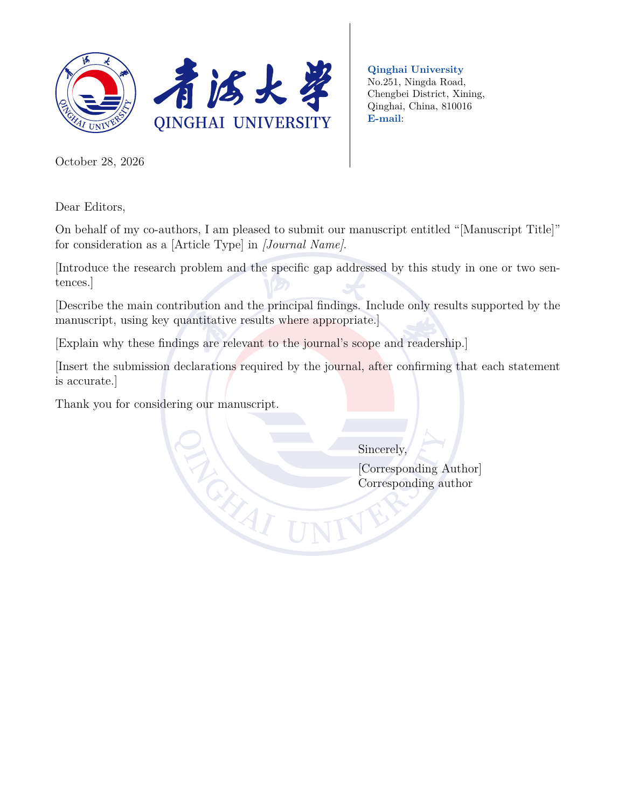

<p align="center">
  
</p>

<h1 align="center">QHU Cover Letter Template</h1>

<p align="center">青海大学 · 英文论文投稿信 · LaTeX 模板</p>

<p align="center">
  <code>XeLaTeX</code> · <code>US Letter / A4</code> · <code>12 pt</code> · <code>无需额外字体</code>
</p>

<p align="center">
  <a href="#preview">模板预览</a> ·
  <a href="#quick-start">快速开始</a> ·
  <a href="#edit-content">填写内容</a> ·
  <a href="#customize">调整版式</a> ·
  <a href="docs/CUSTOMIZATION.md">详细教程与排错</a>
</p>

---

一份面向 <strong>青海大学英文论文投稿</strong> 的 Cover Letter 模板。填写作者信息、论文标题及正文，即可生成带有学校信头和校徽背景的 PDF。

> [!TIP]
> <strong>第一次使用，先只修改 `main.tex`。</strong> 它负责信函内容；`QHUletter.cls` 负责排版。按原版式投稿时，无需修改类文件。

| ✉️ 信头与地址 | 🎨 校徽背景 | ✍️ 正文与落款 |
| --- | --- | --- |
| 左侧学校信头，右侧联系信息，中间黑色竖线 | 居中、等比例、透明度可调，续页继续显示 | 日期左对齐，直接称呼编辑，落款位于右侧 |

<a name="preview"></a>

## 🖼️ 模板预览

<p align="center">
  <a href="main.pdf"></a>
</p>

<p align="center">预览来自模板的实际编译结果。点击图片可查看 PDF。</p>

> [!NOTE]
> <strong>默认保留原地址，专业/学院首行和 E-mail 内容留空。</strong> 正文中的方括号是待替换提示；正式投稿前应全部替换。模板并非学校发布的官方标准信函。

<a name="quick-start"></a>

## 🚀 快速开始

| ① 上传模板 | ② 填写内容 | ③ 编译导出 |
| --- | --- | --- |
| 下载仓库 ZIP，上传到 Overleaf | 编辑 `main.tex`，填写作者和论文信息 | 选择 XeLaTeX，编译两次后下载 PDF |

### 推荐方式：Overleaf

1. 在本仓库的 <strong>Code → Download ZIP</strong> 下载项目。
2. 在 Overleaf 创建项目并上传 ZIP；也可以创建空白项目后，上传下方列出的四个必需文件。
3. 将主文件设为 <strong>`main.tex`</strong>，编译器选择 <strong>XeLaTeX</strong>。
4. 先编译一次确认文件完整，再按下一节填写内容。
5. 完成后编译两次，检查分页和落款，再下载 PDF。

<strong>必需文件：</strong> `main.tex`、`QHUletter.cls`、`qhu_bg.pdf`、`qhu.pdf`。四个文件须位于同一文件夹，名称和大小写保持一致。

<a name="edit-content"></a>

## ✍️ 填写内容

### 1. 姓名与落款

在 `main.tex` 顶部修改以下两条命令：

```latex
\name{Your Name}
\signature{Your Name\\Corresponding author\\Qinghai University}
```

`\\` 表示换行。<strong>实际显示的签名来自 `\signature`</strong>；省略这条命令时，模板使用 `\name` 中的姓名。

### 2. 单位、地址与邮箱

默认地址如下。不填写专业和邮箱时，保持原样即可。

```latex
\address{%
  \strut\\ % 专业/学院名称：默认留空
  \textbf{\color{qhublue}Qinghai University}\\
  No.251, Ningda Road,\\
  Chengbei District, Xining,\\
  Qinghai, China, 810016\\
  \textbf{\color{qhublue}E-mail}: % 邮箱内容：默认留空
}
```

需要填写时：

| 修改内容 | 操作 |
| --- | --- |
| 专业或学院 | 将 `\strut\\` 替换为 `\textbf{\color{qhublue}Your Department or School}\\` |
| 邮箱 | 在 `E-mail}:` 后填入邮箱，例如 `your.name@example.com` |

地址区域固定在右上角，建议不超过七行；增加内容后，检查是否与日期或分隔线下端重叠。

### 3. 日期与称呼

```latex
\date{\today}              % 编译当天的日期
% \date{October 28, 2026}  % 如需固定日期，启用这一行并修改日期
```

称呼在正文开始处设置：

```latex
\opening{Dear Editors,}
```

可根据实际收件人改为 `Dear Editor-in-Chief,` 或具体编辑的称呼。

### 4. 论文标题与正文

| 在 main.tex 中找到 | 替换为 |
| --- | --- |
| `[Manuscript Title]` | 论文完整标题 |
| `[Article Type]` | 目标期刊采用的稿件类型 |
| `[Journal Name]` | 期刊名称 |
| 研究问题、主要贡献、期刊适配等提示段落 | 与当前论文对应的正式投稿信内容 |
| 投稿声明提示段落 | 根据期刊要求和实际情况填写的声明 |

> [!IMPORTANT]
> <strong>写作提示需要整段替换。</strong> 原创性、独家投稿、作者同意和利益冲突等声明须逐项核实，不能把占位提示直接作为正式声明提交。

<a name="customize"></a>

## 🎨 调整版式

<strong>导言区</strong> 指 `main.tex` 中 `\documentclass{...}` 之后、`\begin{document}` 之前的部分。以下常用调整可直接在导言区完成。

| 想调整什么？ | 当前默认值 | 修改方法 |
| --- | --- | --- |
| 正文字号 | `12pt` | 修改 `\documentclass[12pt]{QHUletter}` 中的字号，可选 10、11、12 pt |
| 背景浓淡 | 不透明度 `0.15` | 重定义 `\watermarkopacity`，数值越小越淡 |
| 背景尺寸 | 宽度 `105mm` | 重定义 `\watermarkwidth`，保持等比例 |
| 段间距 | `0.7em` | 设置 `\parskip` |
| 纸张 | US Letter | 使用 `\geometry{a4paper,...}` 改为 A4 |

例如，减淡背景、缩小校徽，并略微减小段间距：

```latex
% 放在 main.tex 的导言区
\renewcommand{\watermarkopacity}{0.08}
\renewcommand{\watermarkwidth}{100mm}
\setlength{\parskip}{0.5em}
```

<details>
<summary><strong>展开：改为 A4 纸张的完整代码</strong></summary>

在 `main.tex` 导言区加入：

```latex
\geometry{
  a4paper,
  left=19.05mm,
  right=22.225mm,
  top=53mm,
  bottom=19mm
}
```

改变左右页边距后，固定定位的信头和地址不会自动跟随移动，请重新检查。背景会随页面中心移动。

</details>

信头大小、右上角地址位置、竖线长度和落款位置，需要修改 `QHUletter.cls` 中的参数。

📖 <strong>[打开自定义与排错指南](docs/CUSTOMIZATION.md)</strong>：含参数对照表、移动方向说明、可复制代码、常见问题和本地编译方法。

## 📁 文件说明

```text
QHU-Cover-Letter-GitHub/
├── README.md                  # GitHub 首页与快速教程
├── main.tex                   # 投稿信内容
├── QHUletter.cls              # 版式设置
├── qhu_bg.pdf                 # 横向学校信头
├── qhu.pdf                    # 页面背景校徽
├── main.pdf                   # 实际编译的示例 PDF
├── .gitignore                 # 忽略编译中间文件
├── images/
│   ├── qhu-letterhead.png      # README 顶部的学校信头
│   └── template-preview.png   # README 中的真实模板预览
├── docs/
│   └── CUSTOMIZATION.md       # 自定义与排错指南
└── tests/
    └── layout_check.tex       # 两页检查样例
```

> [!TIP]
> <strong>上传 GitHub 时，上传此文件夹内的文件和子文件夹。</strong> 让 `README.md` 位于仓库根目录，并保留 `images/`、`docs/`、`tests/` 的目录结构，图片和链接就能正常显示。

## ❓ 常见问题

| 问题 | 处理方法 |
| --- | --- |
| 找不到类文件或图片 | 检查四个必需文件是否同目录、文件名及大小写是否一致 |
| 编译到了测试文件 | 将主文件重新设为 `main.tex` |
| 中文正文显示异常 | 当前模板用于英文信函，中文正文需另行配置中文排版 |
| 背景影响阅读 | 将不透明度改为较小值，例如 `0.08` |
| 落款到了第二页 | 先精简正文或小幅减小段间距，再考虑调整字号 |
| 修改源码后 GitHub 预览没变 | 重新编译并上传 `main.pdf`，同时更新 `images/template-preview.png` |

正文中空一行表示分段；`\\` 主要用于地址和签名内换行。特殊字符要写为 `\&`、`\%`、`\_`、`\#`、`\$`。

<details>
<summary><strong>展开：为什么 README 中出现了两个星号？</strong></summary>

`**文字**` 是 Markdown 的加粗写法。在中英文混排中，如果加粗范围末尾是标点、后面紧接中文，可能无法按预期识别结束标记。

可在标记前后留空格，或使用更明确的 HTML 写法：

```html
一份面向 <strong>青海大学英文论文投稿</strong> 的 LaTeX 模板。
```

本说明的重点内容采用 `<strong>` 标记，避免同类混排问题。参考 [GitHub 格式说明](https://docs.github.com/en/get-started/writing-on-github/getting-started-with-writing-and-formatting-on-github/basic-writing-and-formatting-syntax)。

</details>

## ✅ 已完成的检查

当前模板版本于 <strong>2026-10-28</strong> 完成验证：

- XeLaTeX、pdfLaTeX、LuaLaTeX 均成功编译单页模板，最终日志无警告和文字溢出提示。
- 已检查实际渲染，以及两页文档、空收件人、无主题行、空地址和签名回退的显示。
- 两份 PDF 图片与提供的原压缩包内文件逐字节一致。

修改版式后，可使用 `tests/layout_check.tex` 再次检查。详细命令见 [自定义与排错指南](docs/CUSTOMIZATION.md)。

## 来源说明

本模板由提供的 BNU/HIT/NJU 信函模板改编，类文件保留原作者归属说明。它是个人投稿使用的模板，<strong>并非青海大学发布的官方标准信函模板</strong>。
